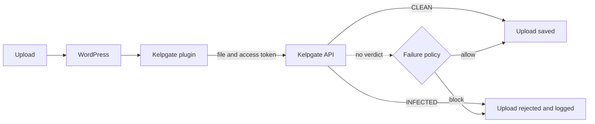

# Kelpgate Malware Scanner for WordPress

[](https://wordpress.org/plugins/kelpgate-malware-scanner/)
[](https://github.com/KelpGate/kelpgate-wordpress/releases)
[](LICENSE)

WordPress plugin that scans uploaded files with the [Kelpgate](https://kelpgate.cloud) malware-scanning API and rejects infected files before WordPress saves them. It covers the WordPress upload pipeline (Media Library and the REST API) and raw multipart uploads handled by form plugins and custom endpoints, and records blocked uploads in an incident log.

The plugin is open source under GPL-2.0-or-later. The Kelpgate scanning service is a commercial hosted product; using it requires a Kelpgate account. No data is sent until the plugin is configured.

## Contents

- [Requirements](#requirements)
- [Installation](#installation)
- [Configuration](#configuration)
- [Operation](#operation)
- [Failure policy](#failure-policy)
- [Security and privacy](#security-and-privacy)
- [Hooks](#hooks)
- [Verification](#verification)
- [Troubleshooting](#troubleshooting)
- [Compatibility](#compatibility)
- [Release process](#release-process)
- [Versioning and support](#versioning-and-support)
- [Licence](#licence)

## Requirements

| Component | Version |
|---|---|
| WordPress | 5.8 or later |
| PHP | 7.4 or later |
| Kelpgate | API client (client ID and secret) from the [Kelpgate Console](https://console.kelpgate.cloud) |

## Installation

1. Install from the [WordPress plugin directory](https://wordpress.org/plugins/kelpgate-malware-scanner/) (**Plugins > Add New**, search for *Kelpgate Malware Scanner*), or download `kelpgate-malware-scanner.zip` from the [latest release](https://github.com/KelpGate/kelpgate-wordpress/releases/latest) and upload it under **Plugins > Add New > Upload Plugin**. Do not use the *Source code* archives.
2. Activate the plugin.
3. Open **Settings > Kelpgate Malware Scanner**, enter the connection settings and select **Test connection**.

Each release includes a `.sha256` file for verifying the download.

## Configuration

Settings are stored through the settings page or defined as constants in `wp-config.php`. A constant overrides the stored value and keeps the value out of the database; this is the recommended method for credentials.

```php
define('KELPGATE_API_URL',       'https://api.kelpgate.cloud');
define('KELPGATE_TOKEN_URL',     'https://auth.kelpgate.cloud/oauth2/token');
define('KELPGATE_CLIENT_ID',     'your-client-id');
define('KELPGATE_CLIENT_SECRET', 'your-client-secret');
```

| Setting | Constant | Default | Description |
|---|---|---|---|
| API URL | `KELPGATE_API_URL` | | Kelpgate API base URL; HTTPS required except for `localhost` |
| Token URL | `KELPGATE_TOKEN_URL` | | OAuth 2.0 token endpoint; HTTPS required except for `localhost` |
| Client ID, client secret | `KELPGATE_CLIENT_ID`, `KELPGATE_CLIENT_SECRET` | | Client credentials. A blank secret field on the settings page keeps the stored secret. |
| Authentication mode | `KELPGATE_AUTH_MODE` | `oauth2` | `oauth2` (client credentials) or `token` (static token) |
| Static token | `KELPGATE_TOKEN` | | Used when the authentication mode is `token` |
| Failure policy | `KELPGATE_FAIL_ACTION` | `block` | `block` or `allow`; see [Failure policy](#failure-policy) |
| Maximum file size | `KELPGATE_MAX_MB` | `50` | 1 to 500 MB |
| Scan timeout | `KELPGATE_TIMEOUT_SECONDS` | `45` | 5 to 300 seconds |
| Trusted proxies | `KELPGATE_TRUSTED_PROXIES` | Loopback and private ranges | Comma-separated addresses or CIDR ranges whose `X-Forwarded-For` header is trusted |

The plugin scans uploads only when the connection settings for the selected authentication mode are complete: API URL, token URL, client ID and secret for `oauth2`; API URL and token for `token`.

## Operation



1. The plugin obtains an OAuth 2.0 access token with the configured credentials, caches it and renews it before expiry. A rejected token is discarded and the request retried once.
2. The file is sent to the scanning API over HTTPS.
3. Only an infected verdict blocks a file. Blocked uploads are recorded in the incident log, which retains the 50 most recent entries and is shown on the settings page.

Files are read into memory for transmission; keep PHP `memory_limit` at least twice the maximum file size.

## Failure policy

| Condition | `block` (default) | `allow` |
|---|---|---|
| Scanner unreachable or returns an error | Rejected | Accepted |
| Authentication failure | Rejected | Accepted |
| File larger than the maximum size | Rejected | Accepted |
| Insufficient PHP memory to buffer the file | Rejected | Accepted |
| Plugin not configured | Accepted | Accepted |

Use `block` where preventing malware takes priority over availability, and `allow` where uploads must continue during a service outage.

## Security and privacy

| Aspect | Behaviour |
|---|---|
| Data sent | The file content and name, over HTTPS, to the configured API URL only |
| Access control | Settings page and connection test require the `manage_options` capability and a valid nonce |
| Secrets | Stored secrets are never written to page output; constants keep them out of the database |
| Rate limiting | Raw upload inspection is limited to 20 files per minute per client address |
| Data retained | Incident records for the 50 most recent blocked uploads: time, file name, detection, SHA-256, client address, user ID |
| Uninstall | Removes settings, incident log and cached tokens |
| Service retention | Clean files are retained briefly and infected files quarantined by the Kelpgate service, according to the plan |

Report vulnerabilities privately through the repository's security advisories (**Security > Report a vulnerability**) or according to the [security policy](https://github.com/KelpGate/.github/blob/main/SECURITY.md).

## Hooks

| Filter | Default | Description |
|---|---|---|
| `kelpgate_trusted_proxies` | Value of `KELPGATE_TRUSTED_PROXIES` | Proxies whose `X-Forwarded-For` header is trusted |
| `kelpgate_raw_scan_limit_per_minute` | `20` | Raw upload inspections allowed per client address per minute |

## Verification

Save the EICAR test string as `eicar.txt` and upload it through **Media > Add New**:

```
X5O!P%@AP[4\PZX54(P^)7CC)7}$EICAR-STANDARD-ANTIVIRUS-TEST-FILE!$H+H*
```

The upload is rejected and an entry appears in the incident log.

## Troubleshooting

| Symptom | Cause |
|---|---|
| Every upload is rejected | The scanner is unreachable or the credentials are invalid while the policy is `block`. Use **Test connection**. |
| No upload is ever blocked | The plugin is not fully configured, or the policy is `allow` during an outage. |
| "Installed more than once" notice | Two copies of the plugin are present. Deactivate and delete the duplicate. |
| Incident log shows a proxy address | Add the load balancer or CDN network to `KELPGATE_TRUSTED_PROXIES`. |
| Large files are rejected | Increase the maximum file size and PHP `memory_limit`. |

With `WP_DEBUG` and `WP_DEBUG_LOG` enabled, blocked uploads are also written to `wp-content/debug.log`.

## Compatibility

Each combination below was installed on WordPress and verified with a clean upload (accepted), an EICAR upload (rejected) and both failure policies, against a simulated scanning API.

| WordPress | PHP |
|---|---|
| 5.8 | 7.4, 8.0 |
| 6.1 | 7.4 |
| 6.4 | 8.0, 8.1, 8.2 |
| 6.9 | 8.1, 8.2, 8.3, 8.4 |
| 7.1 | 8.3 (clean and infected uploads through multipart and raw-body REST requests; failure policies not re-verified) |

All source files lint on PHP 7.4 through 8.4, and the packaged plugin passes the WordPress Plugin Check with no findings. Combinations not listed have not been tested.

## Release process

`./package.sh` builds `kelpgate-malware-scanner.zip` with a single top-level `kelpgate-malware-scanner/` directory, verifies the layout and writes a SHA-256 file. Pushing a `vX.Y.Z` tag that matches the plugin version runs the release workflow, which lints on PHP 7.4, builds the archive and publishes the GitHub release. WordPress.org releases are published separately through the plugin's SVN repository.

## Versioning and support

The plugin follows [Semantic Versioning](https://semver.org) and uses version 1 of the Kelpgate API (`/api/v1`). Fixes, including security fixes, are released for the latest version only. Changes are listed in the [changelog](CHANGELOG.md).

See [getting help](https://github.com/KelpGate/.github/blob/main/SUPPORT.md) or contact support@kelpgate.cloud. Contributions follow the [contributing guide](https://github.com/KelpGate/.github/blob/main/CONTRIBUTING.md).

## Licence

GPL-2.0-or-later. See [LICENSE](LICENSE). The Kelpgate scanning service is subject to its own terms.
